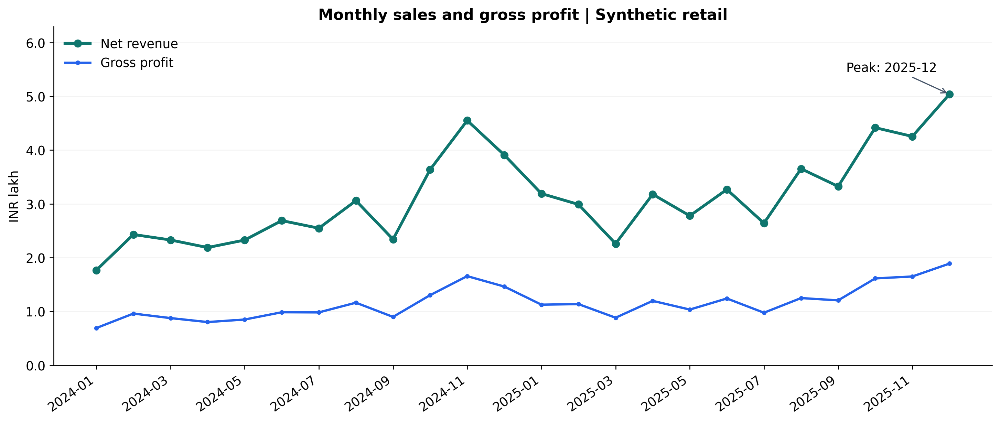
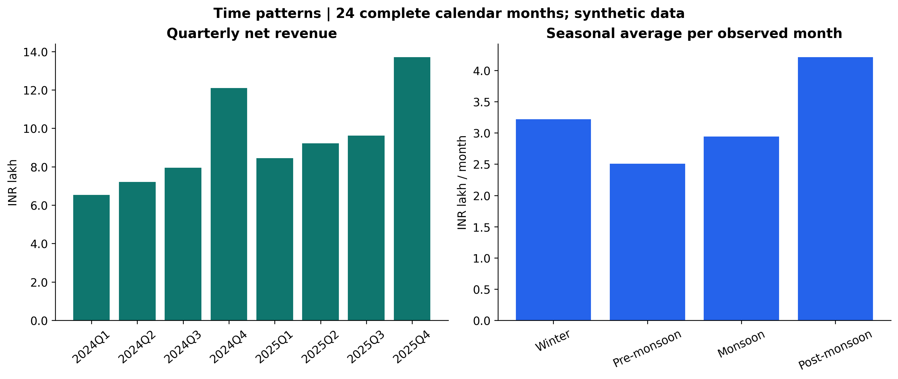
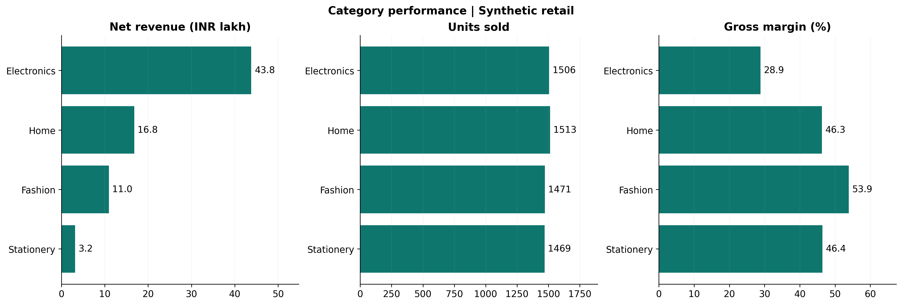
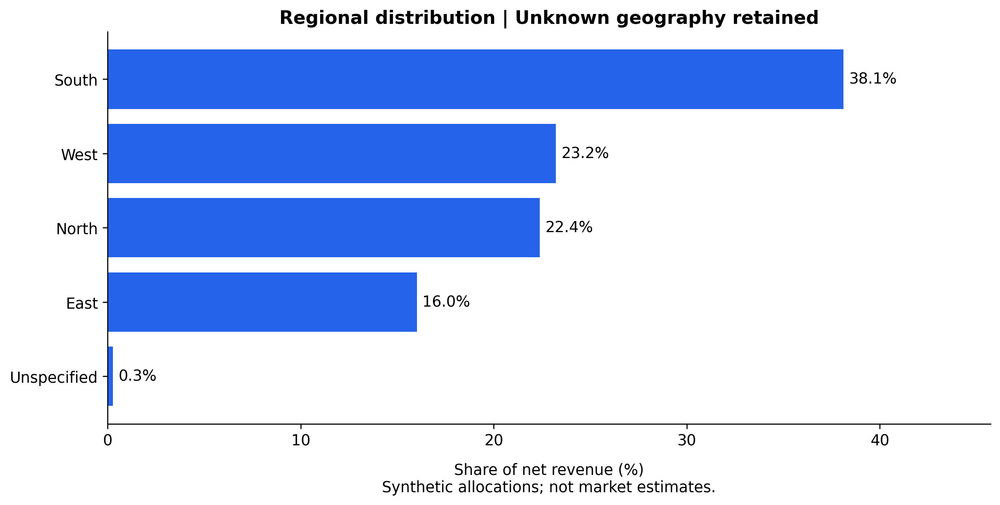
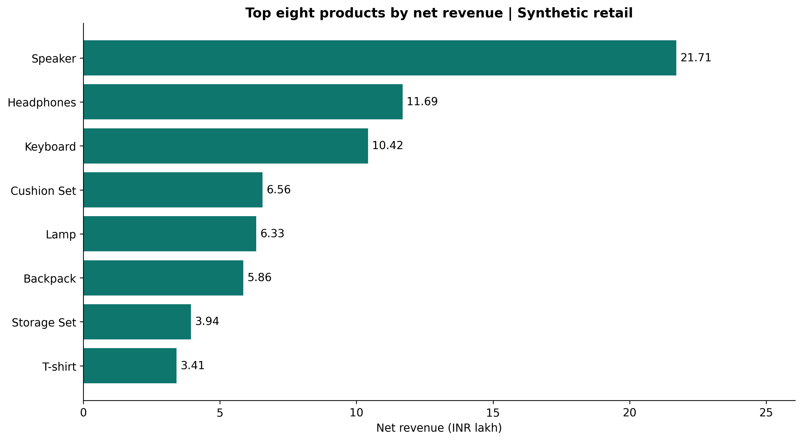

# Retail Sales Analysis

**CodeNova Data Science Batch 01 | Task 1**

[LinkedIn internship announcement](https://lnkd.in/p/gFVhn23S) - my published offer-letter update, tagging the official CodeNova Community page.

An executed exploratory analysis of fictional retail orders, covering financial KPIs, monthly/quarterly/seasonal trends, category and product performance, and regional distribution. Built with Python, Pandas, NumPy, Matplotlib and Jupyter notebook tooling. Runs locally without paid services, API keys or hosting.

## Executive business summary

The synthetic dataset contains **3,129 completed orders and 5,959 units** during 2024-2025, after documented cleaning in the companion Task 2 project.

| Metric | Result |
| --- | ---: |
| Total gross revenue | INR 8,071,441.00 |
| Discounts | INR 595,053.50 |
| Net revenue | INR 7,476,387.50 |
| Cost of goods sold | INR 4,695,651.00 |
| Gross profit | INR 2,780,736.50 |
| Gross profit margin | 37.19% |
| Average order value, net basis | INR 2,389.39 |
| Completed orders | 3,129 |
| Units | 5,959 |

Electronics leads net revenue, while Fashion has the highest gross margin (53.9%) and Home leads unit volume (1,513). South contributes 38.1% of net revenue. December 2025 is the strongest month. These findings reflect deliberately generated data and catalog economics, not actual market demand.

## Strategic recommendations

1. **Inventory:** Review availability of high-revenue electronics, especially speakers. Validate demand persistence and stockouts before increasing purchasing.
2. **Profitability:** Test a limited Fashion cross-sell pilot, because its gross margin is highest. Judge success using incremental profit after campaign costs and returns.
3. **Capacity:** Investigate fourth-quarter demand before seasonal replenishment. The generator deliberately increases Q4 volumes; two years are insufficient for robust seasonality forecasts.
4. **Geography:** South leads revenue, but obtain store counts and customer exposure before changing regional budgets. Unknown geography remains in totals.
5. **Bulk orders:** Flagged quantity outliers account for 20.07% of net revenue. Confirm their legitimacy and recurrence operationally; do not remove valid orders solely because they are unusual.

## Start here

- [Executed notebook](sales_analysis.ipynb): questions, validation, calculations, tables, five embedded charts, reconciliation, sensitivity, and findings.
- [Metric output](output/metrics.json) and [49 reconciliation checks](output/tables/reconciliation.csv).
- [Data dictionary and provenance](DATA_DICTIONARY.md).

## Setup and reproduce

Tested with Python 3.12 on Windows. Use Python 3.11 or 3.12 with the pinned dependencies.

```bash
python -m venv .venv
```

Activate with `.venv\Scripts\activate` on Windows Command Prompt, `.\.venv\Scripts\Activate.ps1` in PowerShell, or `source .venv/bin/activate` on macOS/Linux. If PowerShell activation is restricted, directly use `.venv\Scripts\python.exe` for subsequent commands.

```bash
python -m pip install -r requirements.txt
python analysis.py
python build_notebook.py
python -m unittest discover -s tests -v
```

`analysis.py` recreates all tables and five 240-DPI PNG exports. `build_notebook.py` recreates and executes all notebook cells sequentially in one local IPython interpreter, capturing actual tables, images and console output. It does not require a running notebook server. The supplied notebook already contains its outputs, so a reviewer can inspect it without running code. A local notebook interface is optional; GitHub can render the committed notebook. No live web app is required for this task.

## Charts / demonstration

Actual exports from the executed analysis:











## Method and acceptance checks

All financial sums use integer paise. Discounts round half-up per order. Gross margin is total gross profit divided by net revenue, and AOV uses distinct completed orders. Grouped monetary sums, orders and units reconcile exactly for month, quarter, season, category, region, product and year: **49 checks**. Tests also verify weighted margins/AOV and reject an intentionally corrupted total.

Seasonal categories have unequal numbers of months, so the chart uses net revenue per observed calendar month. The notebook includes monthly year-over-year changes, outlier sensitivity and an exclusion-by-quarter table. `Unspecified` geography is retained in every total.

## Files

| File / folder | Purpose |
| --- | --- |
| `analysis.py` | Financial calculations, tables and annotated chart exports |
| `build_notebook.py` | Rebuild and execute the notebook |
| `sales_analysis.ipynb` | Complete notebook with executed cells |
| `data/` | Cleaned orders, original raw fixture and product catalog |
| `output/charts/` | High-resolution chart exports |
| `output/tables/` | Seven breakdowns, reconciliation, outlier sensitivity and cleaning-loss analysis |
| `tests/` | Financial integrity tests |

## Provenance and limitations

Data was generated for this project with seed **20261010**; the companion `codenova-data-cleaning` project contains the generator and complete cleaning audit. No personal information or third-party dataset is used. The cleaned CSV SHA-256 is `3496b1f75261f24ab1e302fb80b297f02ff89bfa7647a9456df515844a04c3ca`.

The model assumes one product per order, fixed catalog prices/costs, no returns, taxes, shipping or operating costs, and only two years of observations. Gross profit is not net profit. Defects were injected into early 2024 rows, so cleaning losses bias year comparisons. The 189 quantity outliers remain flagged and retained. Recommendations are illustrative hypotheses, not causal claims.

Prepared with AI assistance; review the code, reproduce the analysis and understand the methods before submitting it as internship work. No claim of certification, submission or independent unaided authorship is made.
